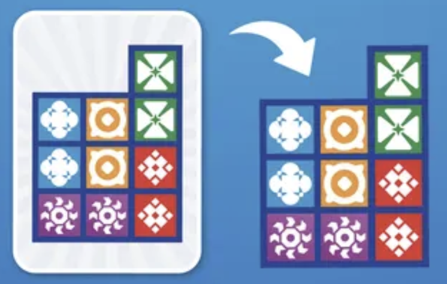

+++
date = '2026-11-27T12:55:02-05:00'
draft = false
title = 'Solving Uzzle'
math = true
+++



### Uzzle at Thanksgiving
Uzzle is a puzzle game made of wooden blocks and a deck of pattern cards. Each card shows a $4\times3$ grid, where every cell is either blank or one of five colors: red, purple, orange, blue, or green. The player has five rectangular blocks, each covering a $2\times1$ area, and each of a block's four long faces shows a pair of colors. The goal is to place all five blocks, horizontally or vertically, so that the faces showing on top match the card exactly.



Since we have five colors, we can determine how many possible combinations and repeat patterns there are. With five colors, there are $\binom{5}{2}=10$ pairs of distinct colors, plus $5$ doubles (RR, PP, etc.), for $15$ combinations in total. Note that we have "commutativity" on the blocks: flipping a block end-to-end turns RG into GR. Five blocks with four faces each gives $20$ faces, so exactly $5$ combinations show up twice: RP, RO, PG, OB, and BG. Here's the full set:

| Block | Face 1 | Face 2 | Face 3 | Face 4 |
|:-----:|:------:|:------:|:------:|:------:|
| 1 | RR | PG | OB | OG |
| 2 | RO | PP | OB | BG |
| 3 | RP | RO | PB | GG |
| 4 | RG | PO | PG | BB |
| 5 | RP | RB | OO | BG |
{style="display: table; margin-left: auto; margin-right: auto;"}

Since every puzzle uses all five blocks, every card has exactly $10$ colored cells, leaving only $2$ blanks on a $12$-cell grid.

### My first instinct
People who know me won't be surprised: my first instinct was linear programming. Playing by hand with my family, I noticed that some placements are completely determined. If a line of colored cells is surrounded by blanks or the border of the grid, there's only one way to split it into blocks; start at one end and pair cells off such that each pair is a face on one of the blocks. My plan was a preprocessor that knocks out these forced placements, followed by an integer program to handle the rest.

However, further thought ruled out this approach. Once you've decided where the five $2\times1$ pieces go, there are at most $5!=120$ ways to hand out the blocks, and no block repeats a pair, so choosing a block for a spot also chooses its face. The number of ways to split $10$ cells into dominoes on a $4\times3$ grid is tiny. The search space is miniscule. An integer program would spend more time getting built than solving!

### Generalizing the line trick into an algorithm
It turns out the preprocessor idea is the whole solver, as long as we generalize it a bit. Consider any colored cell that hasn't been covered yet. Its *options* are the ways it could be covered: a colored, uncovered neighbor, paired with an unused block that has a face matching the two colors. The ends of a line are exactly the cells with one option, but so is a cell whose only neighbor would need a block that's already been used.

This suggests a backtracking search that always branches on the most constrained cell:

1. Find the uncovered colored cell with the fewest options.
2. If it has $0$ options, this branch is a dead end, and we rollback until we have no contradictions.
3. If it has $1$ option, it's forced; place it.
4. Otherwise, try each option in turn.
5. Repeat until every colored cell is covered.

Moves that determine a face are made first. The only real branching happens in blobs like a $2\times2$ square, which can be split horizontally or vertically, and even then the colors usually rule one split out.

This is what the solver looks like on a level 4 card. The left grid is the card (with `.` for blank), and the right grid shows which block covers each cell:

```
   R B O G      4 2 1 1
   G G R B      4 2 5 5
   . O R .      . 3 3 .
  Block 1: face OG, horizontal at (1,4)-(1,3)
  Block 2: face BG, vertical at (1,2)-(2,2)
  Block 3: face RO, horizontal at (3,2)-(3,3)
  Block 4: face RG, vertical at (1,1)-(2,1)
  Block 5: face RB, horizontal at (2,3)-(2,4)
```

### How's the performance?
No Gurobi this time! I wrote the whole thing by hand in under $300$ lines of C with no dependencies. The search finds *every* solution, not just the first; this matters, since a card can have more than one when two blocks share a pair (blocks $2$ and $3$ both have RO, for instance). We use regular old Make for building. 

Solving the level 4 card above takes about $2.6$ microseconds on my laptop. A win for the backtracking community, for once.

The C implementation of this algorithm can be found [here](https://github.com/RobbyLawrence/uzzle-solver). 